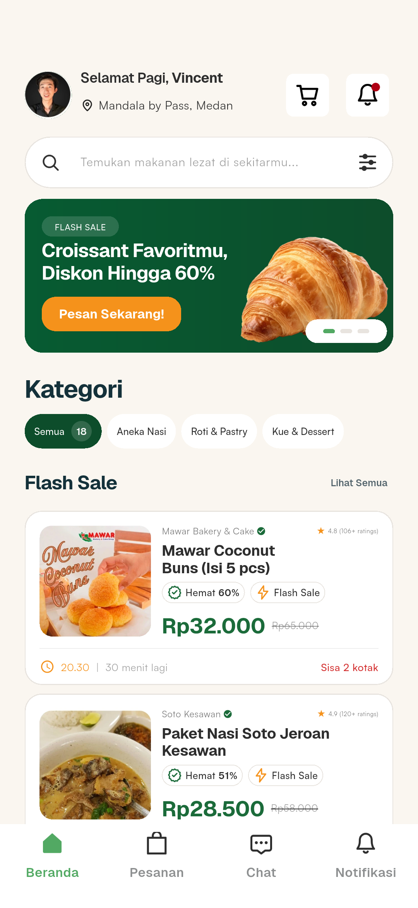
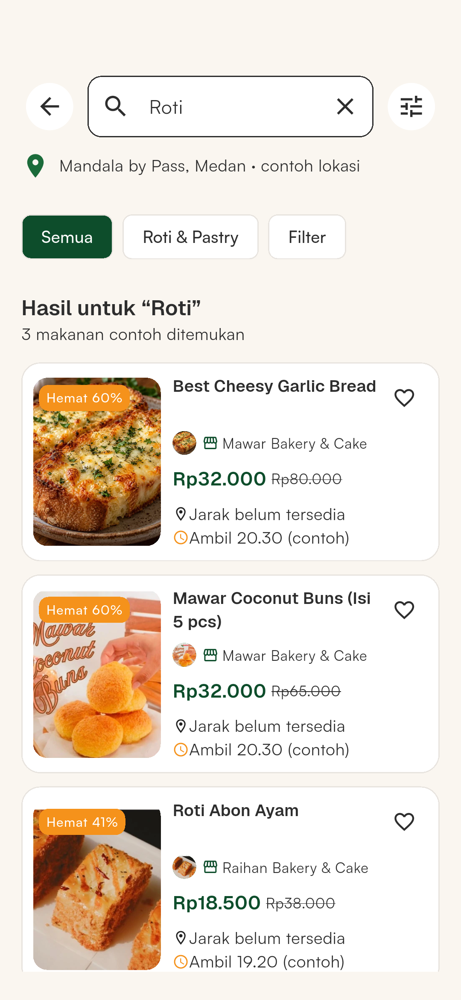
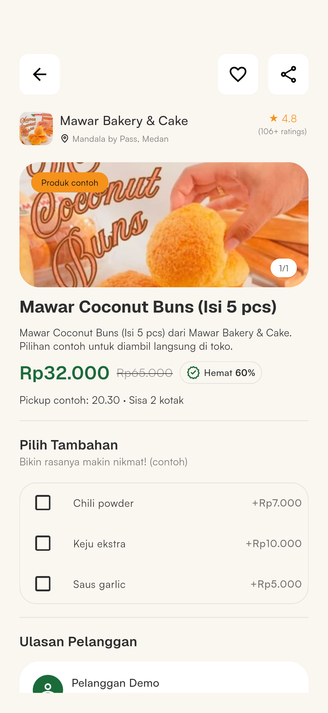
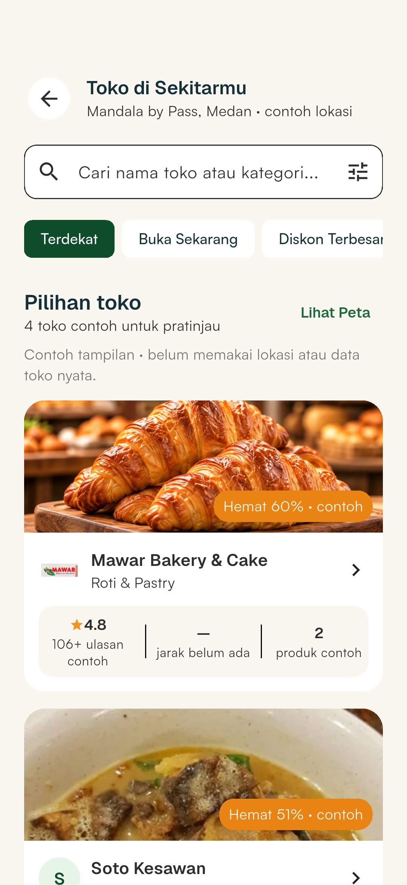
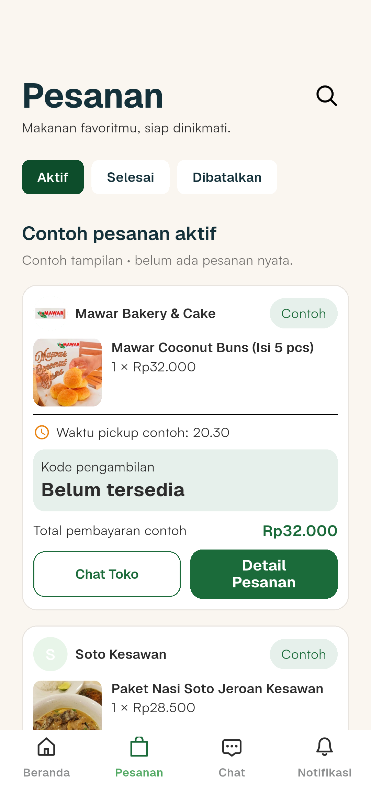
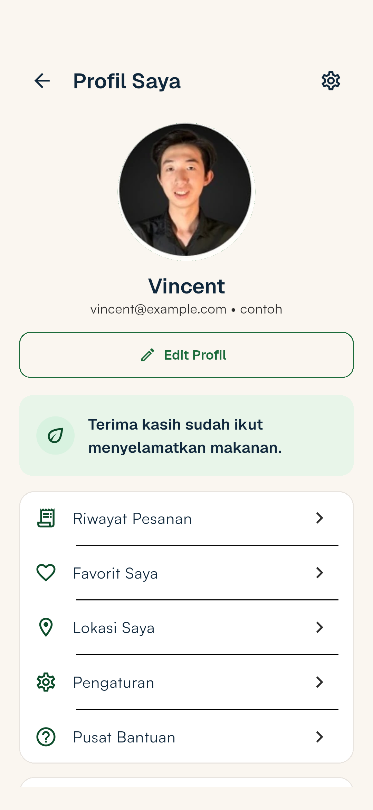

<p align="center"></p>

<h1 align="center">PanganKita</h1>

<p align="center"><strong>Turn surplus into value.</strong></p>

<p align="center">A hyperlocal, pickup-first surplus-food marketplace concept for Indonesia.<br />Helping eligible unsold food reach nearby people while it can still be picked up.</p>

<p align="center"><a href="#app-preview">Explore the app</a> · <a href="#getting-started">Run locally</a> · <a href="docs/screenshots/README.md">Browse all screenshots</a> · <a href="PRD.md">Product requirements</a></p>

---

> **Current status: Flutter demonstration.** PanganKita has an interactive mobile UI backed by local example data and temporary in-memory state. It does **not** authenticate real accounts, reserve inventory, process payments, send messages, or confirm pickups. Screenshots illustrate the prototype, not a live marketplace.

## Why PanganKita?

Eligible unsold food often has a short window in which it can still be offered to nearby customers. PanganKita explores a focused flow: a business offers an eligible surplus-food listing, a nearby customer discovers it, and a pickup can be arranged before the listing deadline.

The longer-term product direction is **local discovery → reservation → pickup → measurable outcome**. That end-to-end transaction is a product goal, **not a feature implemented in this repository today**. The project is intended to be validated locally before claiming operational or environmental impact.

## App preview

Six screenshots from the current Flutter demonstration, captured at the same **1080 × 2338** resolution. Listings, prices, merchants, locations and orders are illustrative, not live marketplace data.

Select a screenshot to see the full-resolution image.

<table align="center">
  <tr>
    <th align="center">Home & discovery</th>
    <th align="center">Search & filters</th>
  </tr>
  <tr>
    <td align="center" valign="top"><a href="docs/screenshots/home-page/homepage-widget-render.png"></a></td>
    <td align="center" valign="top"><a href="docs/screenshots/search/search-results-preview.png"></a></td>
  </tr>
</table>

<p>&nbsp;</p>

<table align="center">
  <tr>
    <th align="center">Product details</th>
    <th align="center">Nearby merchants</th>
  </tr>
  <tr>
    <td align="center" valign="top"><a href="docs/screenshots/products/product-detail-widget-render.png"></a></td>
    <td align="center" valign="top"><a href="docs/screenshots/merchants/nearby-stores-preview.png"></a></td>
  </tr>
</table>

<p>&nbsp;</p>

<table align="center">
  <tr>
    <th align="center">Order examples</th>
    <th align="center">Profile preview</th>
  </tr>
  <tr>
    <td align="center" valign="top"><a href="docs/screenshots/orders/active-orders-widget-render.png"></a></td>
    <td align="center" valign="top"><a href="docs/screenshots/profile/profile-preview.png"></a></td>
  </tr>
</table>

**Want to see the complete interface?** [Explore the full app walkthrough](docs/APP_WALKTHROUGH.md) for each screen, how to reach it and what the buttons do. [Browse the screenshot catalog](docs/screenshots/README.md) for the complete collection.
## Designed product journey

PanganKita is designed as a **hyperlocal, pickup-first surplus-food marketplace** with two sides: food businesses and nearby customers. With a connected backend, the intended experience is:

1. **List:** A business publishes eligible unsold food with a price, quantity, pickup window and seller-provided product information.
2. **Discover:** A nearby customer browses available listings, searches and filters, checks merchant details, and chooses food that fits their pickup window.
3. **Reserve and check out:** The service checks real availability, handles the reservation and applicable payment flow, and gives the customer reliable pickup instructions.
4. **Pick up:** The merchant prepares the food, pickup is verified, and the order reaches its final state.
5. **Learn:** The service records outcomes such as completed pickups and expired listings for product evaluation, rather than assuming an environmental impact.

**This is the intended product flow, not current production functionality.** Today's app demonstrates the customer-facing screens using example data and temporary local state. Merchant publishing, live inventory, server-backed reservations, payments and pickup confirmation are not implemented here. See the [product requirements](PRD.md) for the larger scope and research assumptions.

## What works today?

The table below separates **what you can interact with locally** from **what would require backend or external-service integration**. A visual success, payment or order screen does not mean that a real transaction occurred.


| Area | Interactive demonstration | What is **not** connected |
| --- | --- | --- |
| Welcome and account flows | Splash, welcome, login/registration forms, local OTP and password-recovery previews | Server accounts, real authentication, email or SMS |
| Food discovery | Example feed, category filtering, local search, price filters, product details and add-ons | Live inventory, availability, distance-based matching |
| Merchants and location | Example store profiles, nearby-store list, illustrative map/directions, session-only area selection | Live merchant data, maps, GPS or route computation |
| Cart and checkout | Session-only cart with quantities and integer-rupiah totals; checkout and payment-result screens | Reservations, payment capture, QR payment generation or persisted orders |
| Orders and reviews | Active/completed/canceled example tabs, local order search, detail/help/pickup/review previews | Actual order history, pickup codes, confirmations or submitted reviews |
| Messages and notifications | Example conversations, temporary typed messages, notification filters and local read state | Message delivery, push notifications or saved conversations |
| Profile and settings | Example profile, favorites, edit form, support and settings screens | Persisted account edits, user preferences or real customer support |

The app intentionally marks unavailable integrations rather than silently pretending those operations succeeded. See [implementation notes](docs/IMPLEMENTATION.md) for the boundaries of individual screens.

## Getting started

### Requirements

- [Flutter](https://docs.flutter.dev/get-started/install) **3.47.4**, matching the repository CI configuration, with a compatible Dart SDK (CI uses Dart 3.13.3).
- Android SDK and an emulator or an Android device for mobile testing; Android debug builds also use Java 17 in CI.
- Python 3 to download the licensed Satoshi font files from their official source.
- Network access during the initial dependency and font setup.

From the repository root in **PowerShell**:

```powershell
cd app
flutter --version
python ..\.github\scripts\fetch_satoshi.py
flutter pub get --enforce-lockfile
flutter devices
flutter run -d emulator-5554
```

Replace `emulator-5554` with the **full ID shown by `flutter devices`** on your machine, or use `flutter run` to choose a supported device. You do not need to restart an already-running emulator. In the Flutter terminal, press `r` to hot reload or `R` to hot restart.

For Android setup and troubleshooting, see the [Flutter app developer guide](app/README.md). This repository does not currently maintain a Flutter web target.

### Fonts and assets

The branded UI uses **Geist** for prominent titles and actions, and **Satoshi** for body text, inputs and supporting details. The included Geist assets and license live under `app/assets/fonts/`. The Satoshi files and their license are **not committed**: `fetch_satoshi.py` downloads and hash-checks the files for local use. Do not commit the downloaded font binaries. See the [design contract](docs/DESIGN.md) for the typography and brand rules.

## Project layout

```text
.
├── app/
│   ├── lib/
│   │   ├── app/                  # App composition, routes and theme
│   │   ├── features/
│   │   │   ├── onboarding/       # Welcome, auth-form and recovery previews
│   │   │   └── discovery/        # Current UI screens and demo models
│   │   ├── shared/               # Reusable app-level UI helpers
│   │   └── main.dart
│   ├── test/                     # Widget and demo-behavior tests
│   └── assets/                   # Brand and prototype artwork
├── docs/
│   ├── architecture/             # Engineering boundaries and guidance
│   └── screenshots/             # 37 unique captures grouped by user-facing flow
├── backend/                     # Future-facing documentation; no active API
├── research/                    # Research guidance and material
├── PRD.md                        # Product requirements and hypotheses
└── README.md
```

The current `features/discovery/` directory owns more screens than its name suggests. A future, separately validated cleanup can introduce clearer feature boundaries; **this README update does not reorganize Flutter source files**. The architectural direction is feature-first with lightweight internal layering, not empty `domain/`, `data/` or `services/` folders created for appearance.

## Quality checks

From `app/` after installing the fonts and dependencies:

```powershell
dart format --output=none --set-exit-if-changed .
flutter analyze --fatal-infos --fatal-warnings
dart run dart_code_linter:metrics analyze --fatal-style --fatal-performance --fatal-warnings lib
dart run dart_code_linter:metrics check-unused-code --analyze-private-members lib
dart run dart_code_linter:metrics check-unused-files lib
dart run dart_code_linter:metrics check-unnecessary-nullable lib
dart run dartrics analyze --snapshot none --strict-dismiss --fatal-warnings lib
flutter test --coverage
flutter build apk --debug
```

The repository also runs automated formatting, analysis, test, integrity, and Android-build workflows in GitHub Actions. A successful demo build does not establish production-grade authentication, order correctness, or payment handling.

## Documentation and contribution

| Resource | Purpose |
| --- | --- |
| [Flutter app guide](app/README.md) | Setup, local commands, debugging and test workflow |
| [Screenshot library](docs/screenshots/README.md) | All captured example screens, grouped by feature |
| [Product requirements](PRD.md) | Product scope, constraints, future hypotheses and validation goals |
| [Architecture director](docs/ARCHITECTURE.md) | Engineering principles and dependency boundaries |
| [Design contract](docs/DESIGN.md) | Brand, typography and screenshot-fidelity rules |
| [Implementation notes](docs/IMPLEMENTATION.md) | Screen-level prototype behavior and limitations |
| [Contributor guide](CONTRIBUTING.md) | Setup, validations, scope and contribution workflow |
| [Security policy](SECURITY.md) | Responsible disclosure and private reporting prerequisites |
| [Code of conduct](CODE_OF_CONDUCT.md) | Community expectations and reporting guidance |
| [AI contribution guardrails](rules.md) | Agent-specific branch, review, and authorization requirements |
| [Pull request template](.github/PULL_REQUEST_TEMPLATE.md) | Required verification and evidence in contributions |

Human contributors should start with the [contributor guide](CONTRIBUTING.md). AI-assisted work also follows [root agent instructions](AGENTS.md) and applicable scoped `AGENTS.md` files. Keep product claims evidence-based, preserve the existing brand identity, use isolated branches for focused changes, and document whether new behavior is **local UI**, **mock/demo**, or **actually connected**.

**Project and asset licensing:** No repository-wide `LICENSE` file is currently declared. Do not assume that public visibility grants blanket reuse rights. Fonts, images and other third-party assets may have separate terms; check their provenance and permissions before redistributing them.
