# PanganKita | Full App Walkthrough

A screen-by-screen tour of the **Flutter demonstration**. The screenshots were captured on a single Android emulator viewport (**1080 × 2338 physical pixels**); all retained images have the same dimensions. This is a guided navigation/reference document, not proof of a running backend or mobile responsiveness across other devices.

> **Demo-only:** Example stores, food, users, prices, orders, pickup windows, payment screens and conversations are illustrative. This repository does not operate real authentication, reservations, payments, messaging or GPS navigation.

## At a glance

```text
Welcome / demo account screens
              |
              v
Home --> Search --> Product --> Cart --> Checkout --> Payment previews
  |                      |
  +--> Nearby merchants -+--> Store --> Map / Directions
  |
  +--> Orders --> Details / Pickup preview --> Review preview
  |
  +--> Chat --> Merchant chat
  +--> Notifications
  +--> Profile --> Edit / Favorites / Settings / Support / Location
```

Routes and buttons shown below are the **implemented prototype interactions**. Some screenshots were taken through direct test-route navigation, so a capture is not proof that every screen is accessible through a complete real-world journey.

## Screen index

- [Onboarding & recovery](#onboarding--recovery) (2 screenshots)
- [Home & food discovery](#home--food-discovery) (5 screenshots)
- [Merchants & locations](#merchants--locations) (7 screenshots)
- [Cart, checkout & payment previews](#cart-checkout--payment-previews) (6 screenshots)
- [Orders, pickup & reviews](#orders-pickup--reviews) (8 screenshots)
- [Chat & notifications](#chat--notifications) (3 screenshots)
- [Profile, settings & support](#profile-settings--support) (6 screenshots)

---

## Onboarding & recovery

### Welcome

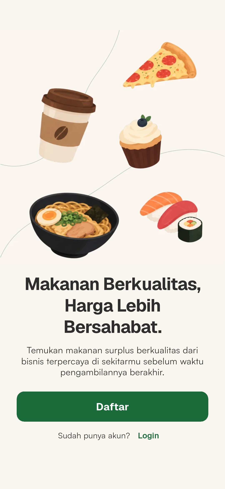

**How to reach it:** Launch PanganKita and continue past the splash screen.

**What happens when you interact:** Choose **Daftar** for the local registration preview or **Login** for the sign-in form.

**Important limitation:** Forms and verification are local demonstrations; no real account is created.


### Password recovery

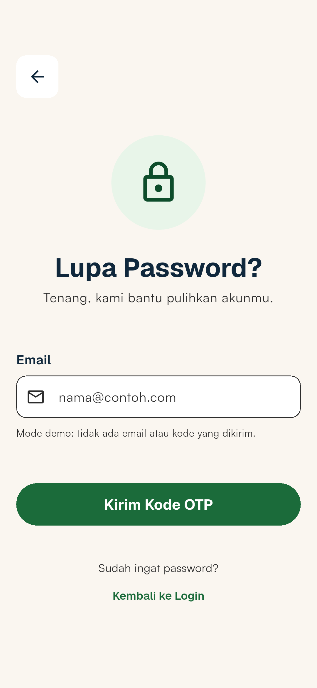

**How to reach it:** From Login, choose the password-recovery action.

**What happens when you interact:** Enter an example email and choose **Kirim Kode OTP** to proceed to the demonstration verification flow.

**Important limitation:** No email, SMS, or password-reset request is sent.


[Back to screen index](#screen-index)

---

## Home & food discovery

### Home feed

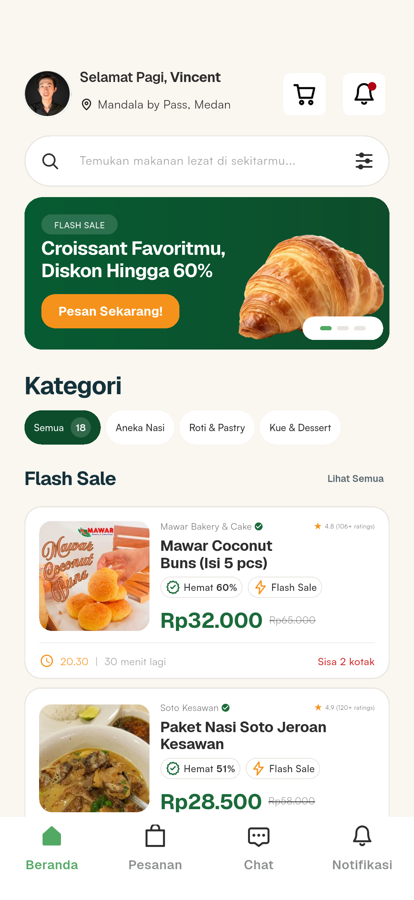

**How to reach it:** Continue through the local introductory flow to **Beranda**.

**What happens when you interact:** Use the search field for local listings, select a category, open product cards, use the cart and notification icons, or use the bottom navigation. The merchant discovery section opens nearby-store previews.

**Important limitation:** Inventory, pickup deadlines, ratings, and locations are illustrative.


### Search results

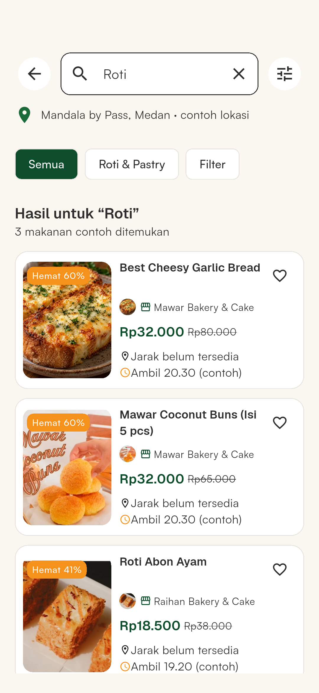

**How to reach it:** From Home, submit a food search such as **Roti**.

**What happens when you interact:** Select a result to open its product detail; change the query or open **Filter pencarian** to refine local examples.

**Important limitation:** Search runs against bundled fixtures, not a live listing service.


### Search filters

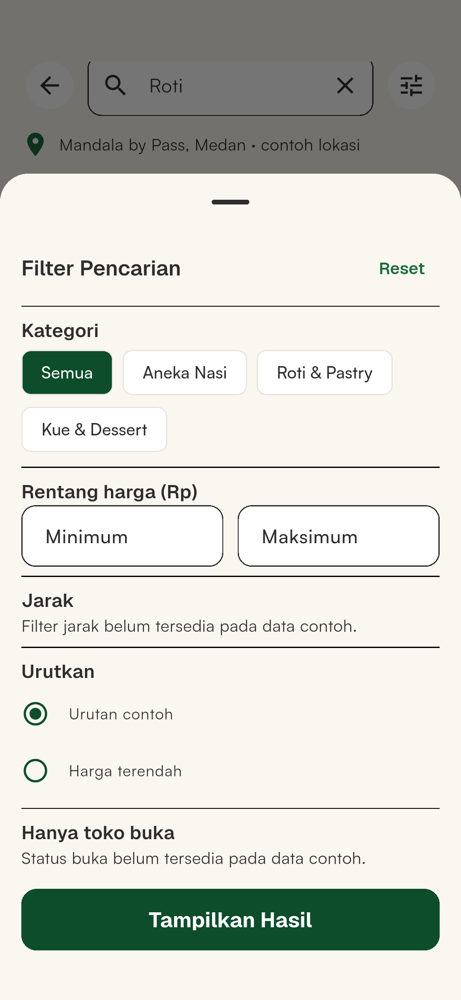

**How to reach it:** On Search, select the **Filter pencarian** control.

**What happens when you interact:** Adjust supported category/price and sort options, then select **Tampilkan Hasil**; **Reset** clears local filters.

**Important limitation:** Actual distance and merchant opening-hours filters are unavailable.


### No search results

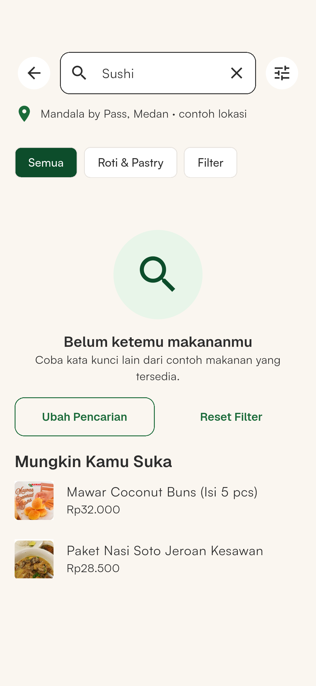

**How to reach it:** Search for a term with no matching sample foods, such as **Sushi**.

**What happens when you interact:** Use **Ubah Pencarian**, **Reset Filter**, or a sample recommendation to recover.

**Important limitation:** An empty result reflects only the local demonstration catalog.


### Product details

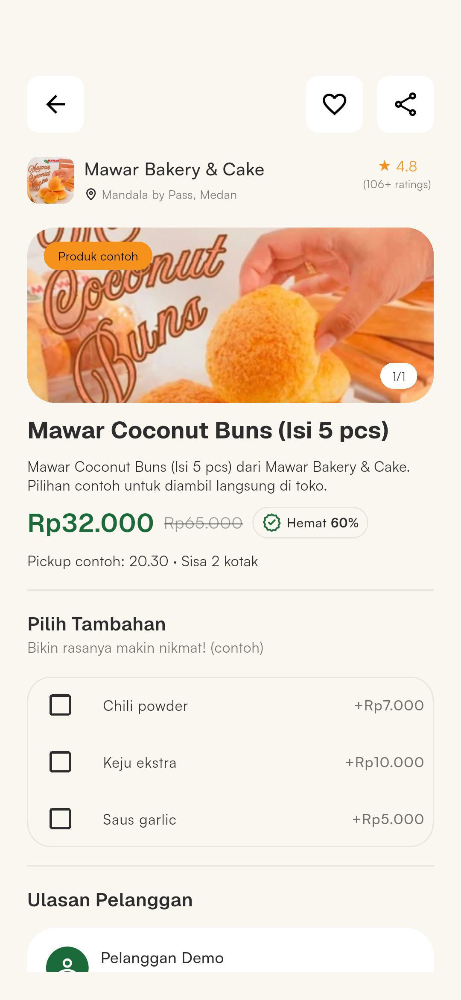

**How to reach it:** Tap a food card in Home, Search, or a store listing.

**What happens when you interact:** View the illustrative merchant and food information; choose optional add-ons and quantity, then use **Tambah ke Keranjang (Demo)** to open the session cart.

**Important limitation:** Favorites, stock, ratings and prices are illustrative; adding to cart does not reserve inventory.


[Back to screen index](#screen-index)

---

## Merchants & locations

### Nearby merchant list

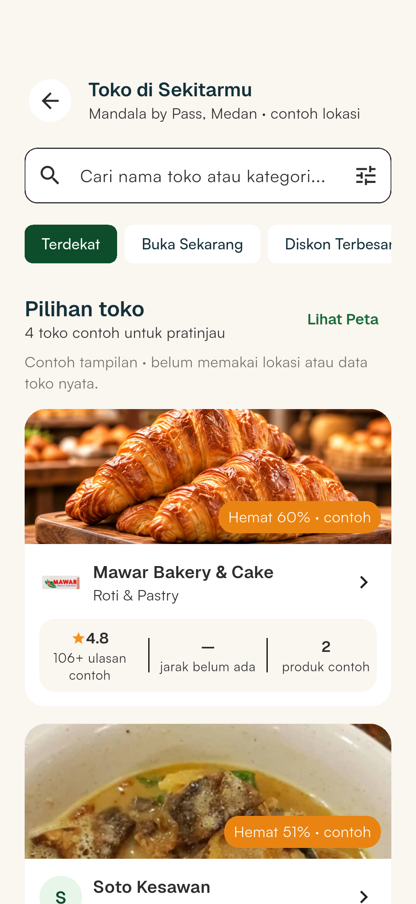

**How to reach it:** From the Home merchant-discovery section, select the link to see nearby stores.

**What happens when you interact:** Search example merchants, select a store card to view its details, or press **Lihat Peta**.

**Important limitation:** The list is not ranked using live geolocation or live merchant data.


### Illustrative merchant map

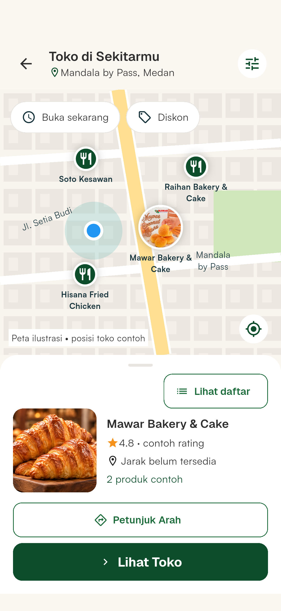

**How to reach it:** Choose **Lihat Peta** from nearby stores.

**What happens when you interact:** Select a sample map marker to inspect a merchant; from the detail sheet choose **Lihat Toko** or **Petunjuk Arah**.

**Important limitation:** Markers and distances are illustrative rather than live map coordinates.


### Directions preview

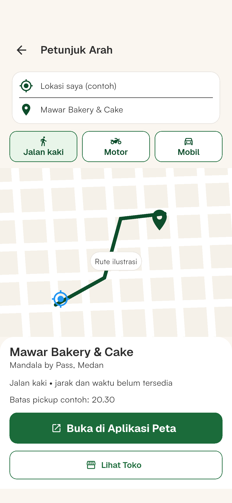

**How to reach it:** From an illustrative merchant map sheet, choose **Petunjuk Arah**.

**What happens when you interact:** Toggle **Jalan kaki**, **Motor**, or **Mobil**; **Lihat Toko** opens the example merchant.

**Important limitation:** No real route, ETA, or live external map launch is provided.


### Store detail: products

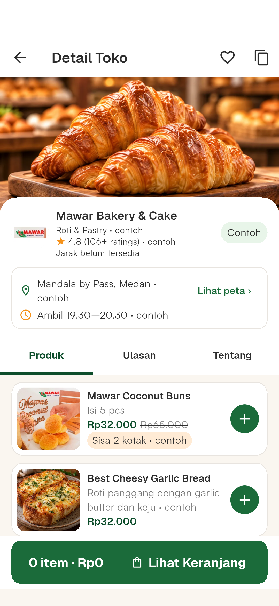

**How to reach it:** Select a merchant from the nearby-store list or map.

**What happens when you interact:** Explore **Produk**, **Ulasan**, and **Tentang** tabs; product add controls affect only the demo cart.

**Important limitation:** Merchant information, pickup times and ratings are sample data.


### Store reviews tab

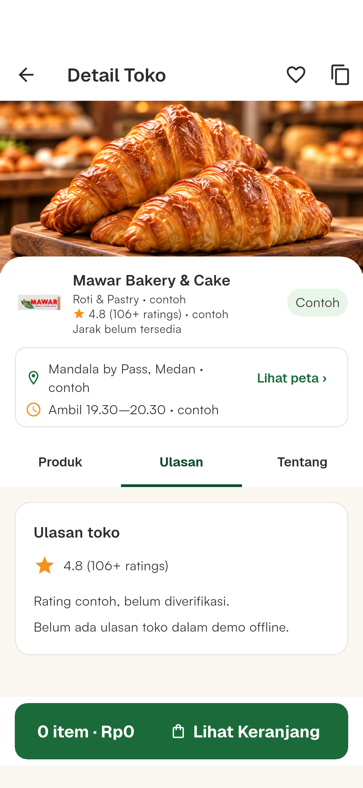

**How to reach it:** On Store Detail, select **Ulasan**.

**What happens when you interact:** View the sample rating and the empty local review state; switch tabs to continue browsing.

**Important limitation:** No real customer reviews are fetched.


### Store about tab

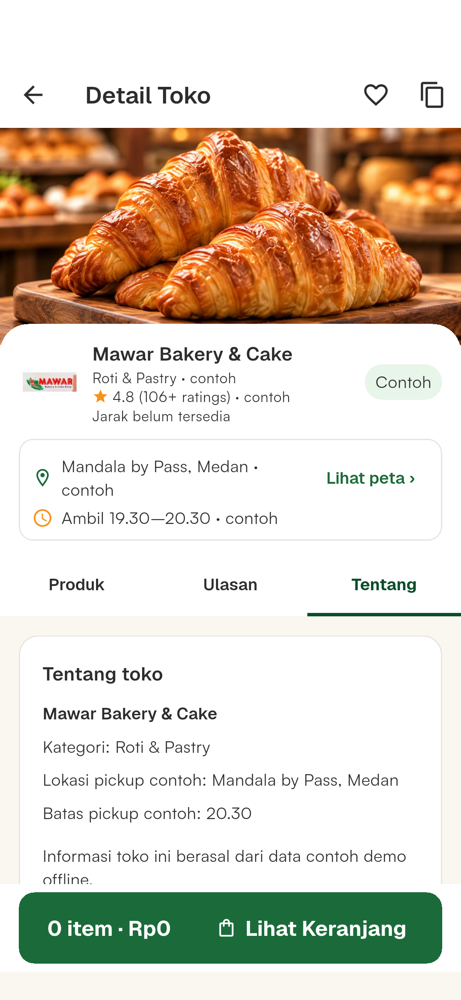

**How to reach it:** On Store Detail, select **Tentang**.

**What happens when you interact:** Read example category, pickup address and timing; use another tab to return to products.

**Important limitation:** These details do not establish operational store hours or pickup availability.


### Location selection

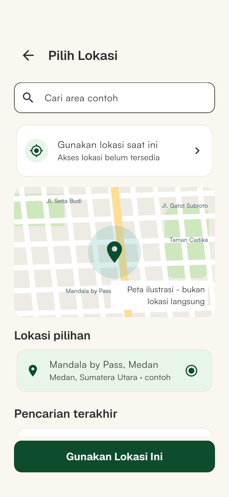

**How to reach it:** Tap the area label on Home, or open location selection from the example profile.

**What happens when you interact:** Choose one of the example Medan areas and confirm to change the Home area for the current session.

**Important limitation:** The app does not request or use live device location and the area is not persisted.


[Back to screen index](#screen-index)

---

## Cart, checkout & payment previews

### Cart

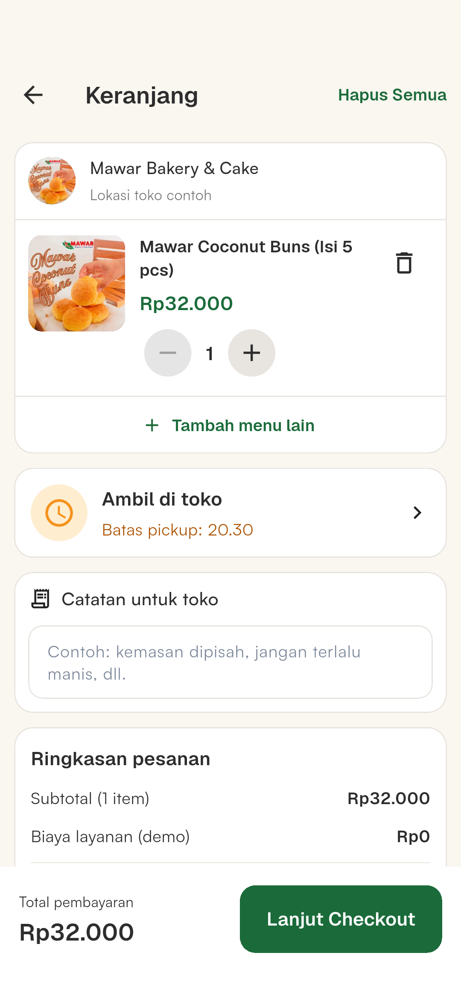

**How to reach it:** From Product Details, select **Tambah ke Keranjang (Demo)**, or tap the Home cart button.

**What happens when you interact:** Modify quantities, remove items, clear the example cart, or continue to Checkout.

**Important limitation:** This is session-only state, not an order or reservation.


### Checkout

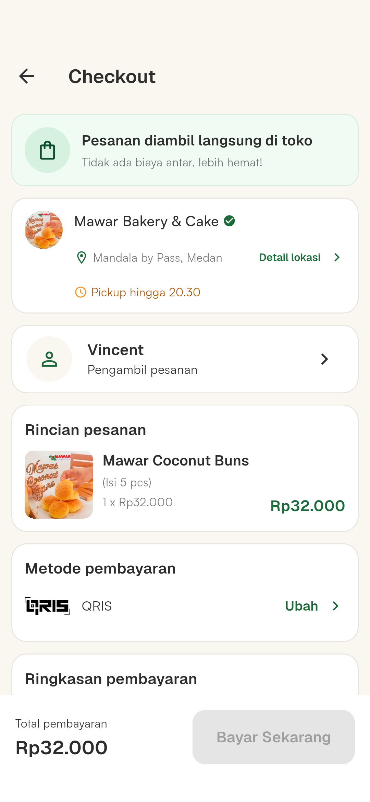

**How to reach it:** Continue from a non-empty demo cart.

**What happens when you interact:** Review line items, amounts and sample pickup details; select **Ubah** to inspect the payment-method sheet. After acknowledging the demo terms, **Bayar Sekarang** opens the payment-status preview.

**Important limitation:** No charge, reservation, payment request or actual order is created.


### Payment-method sheet

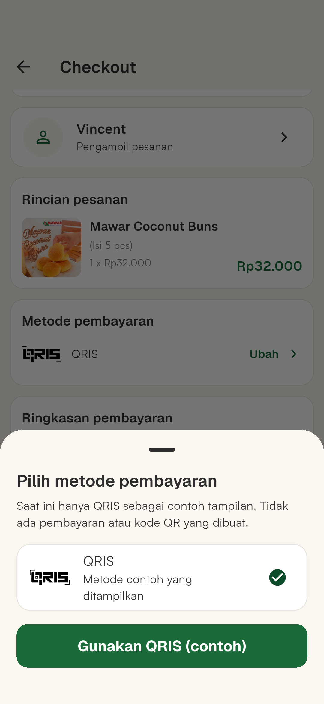

**How to reach it:** On Checkout, select **Ubah** next to the illustrative QRIS method.

**What happens when you interact:** Inspect the QRIS-only example, then choose **Gunakan QRIS (contoh)** to dismiss the sheet.

**Important limitation:** No payment token, account, or scannable payment request is generated.


### Payment status

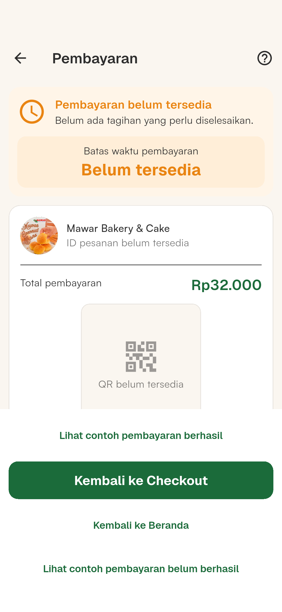

**How to reach it:** Acknowledge demo pickup terms on Checkout, then select **Bayar Sekarang**.

**What happens when you interact:** Use the explicit preview actions to view sample successful or unsuccessful payment layouts; navigate back to Checkout or Home.

**Important limitation:** The QR code, countdown, transaction ID and payment confirmation are unavailable.


### Success layout preview

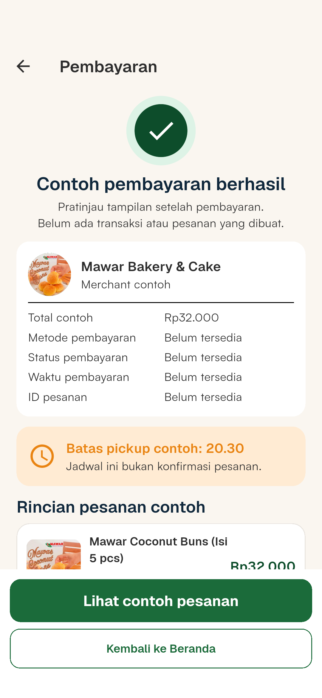

**How to reach it:** On the payment-status page, choose **Lihat contoh pembayaran berhasil**.

**What happens when you interact:** Review the example success layout and return to Home or view illustrative orders.

**Important limitation:** This is a sample state; a real payment has not succeeded.


### Unsuccessful payment layout preview

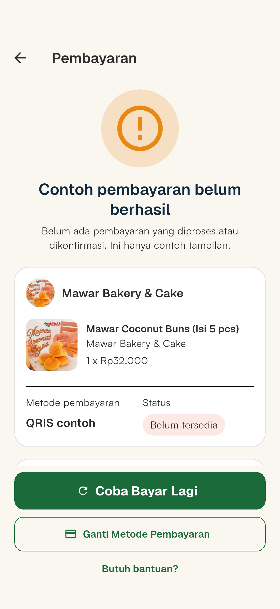

**How to reach it:** On the payment-status page, choose **Lihat contoh pembayaran belum berhasil**.

**What happens when you interact:** Review example next steps or the payment-method preview.

**Important limitation:** No failed transaction has actually been recorded.


[Back to screen index](#screen-index)

---

## Orders, pickup & reviews

### Active order examples

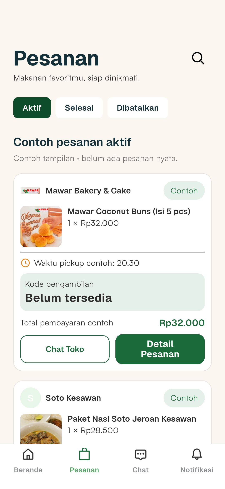

**How to reach it:** Select **Pesanan** in the bottom navigation.

**What happens when you interact:** Use **Aktif**, **Selesai**, and **Dibatalkan** to switch examples. On an active example, **Detail Pesanan** opens order details and **Chat Toko** opens a sample conversation.

**Important limitation:** These cards are demonstrations and are not connected to checkout.


### Completed order examples

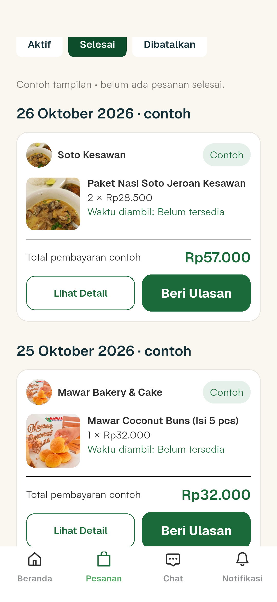

**How to reach it:** On Orders, select **Selesai**.

**What happens when you interact:** Explore the example completed cards and their **Lihat Detail** / **Beri Ulasan** actions when visible.

**Important limitation:** Completion and pickup times are illustrative; the snapshot may be scrolled below the page title.


### Canceled order examples

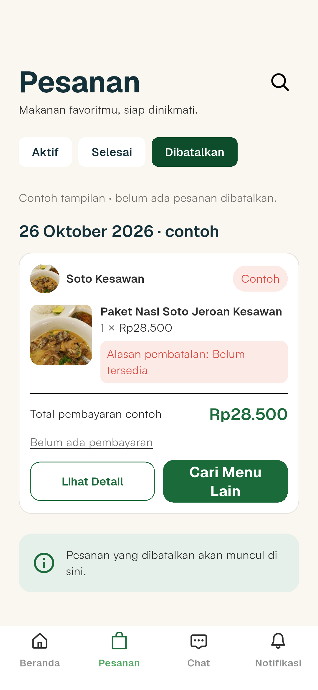

**How to reach it:** On Orders, select **Dibatalkan**.

**What happens when you interact:** Review the cancellation example and use **Cari Menu Lain** to return to discovery.

**Important limitation:** No cancellation or inventory restoration occurred.


### Search order examples

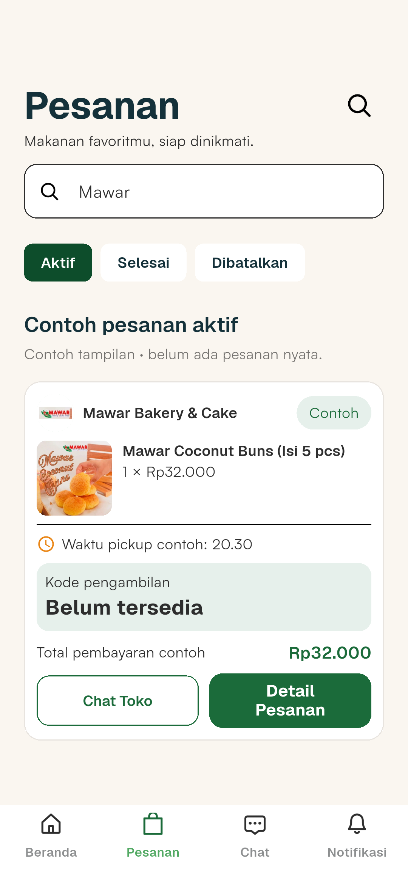

**How to reach it:** On Orders, tap the search icon labelled **Cari pesanan**.

**What happens when you interact:** Type a sample merchant or product name to filter the local cards across tabs.

**Important limitation:** Search does not query real order history.


### Order detail

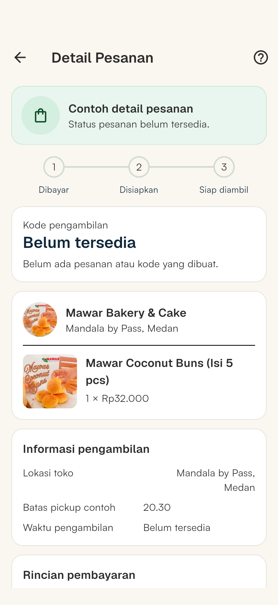

**How to reach it:** From an active example, select **Detail Pesanan**.

**What happens when you interact:** Review the sample product, merchant and timeline and select **Bantuan Pesanan** for offline guidance.

**Important limitation:** Real order IDs, payments, codes and pickup confirmations are unavailable.


### Order help sheet

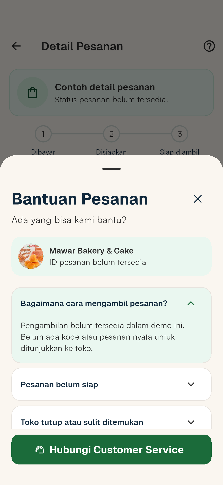

**How to reach it:** From Order Detail, select **Bantuan Pesanan** or the help icon.

**What happens when you interact:** Expand the offline question-and-answer rows; close the sheet to return.

**Important limitation:** This is not a live support channel.


### Pickup preview

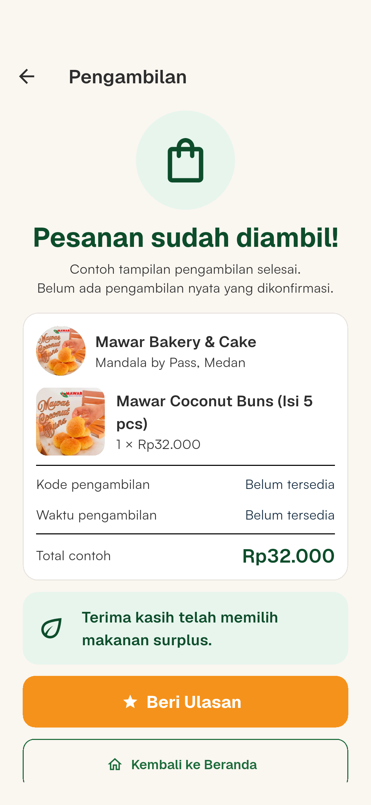

**How to reach it:** On completed-order examples, select **Lihat Detail** to open a pickup illustration.

**What happens when you interact:** Inspect the placeholder pickup details and use **Beri Ulasan** to open the review form.

**Important limitation:** No usable pickup code or confirmed pickup exists.


### Review form preview

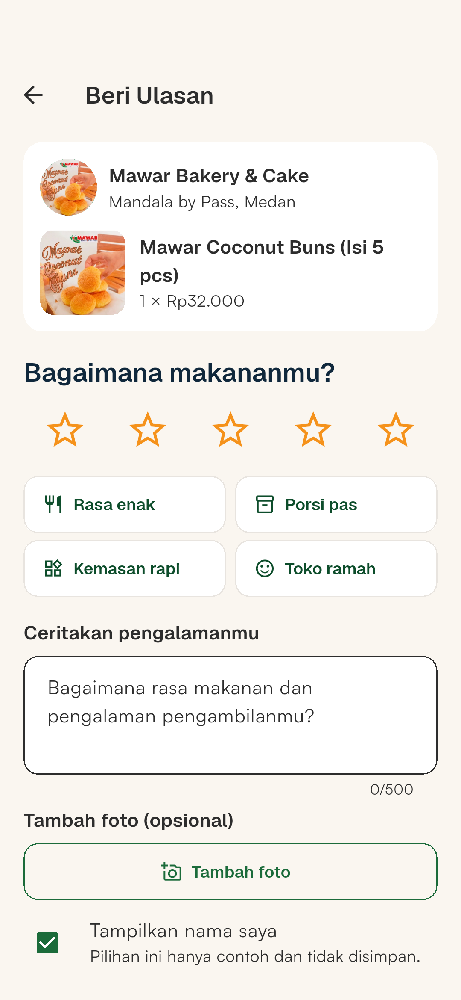

**How to reach it:** From an example completed order or pickup page, choose **Beri Ulasan**.

**What happens when you interact:** Adjust rating, tags and draft text; inspect the photo and submission controls.

**Important limitation:** The review is not uploaded or saved.


[Back to screen index](#screen-index)

---

## Chat & notifications

### Chat list

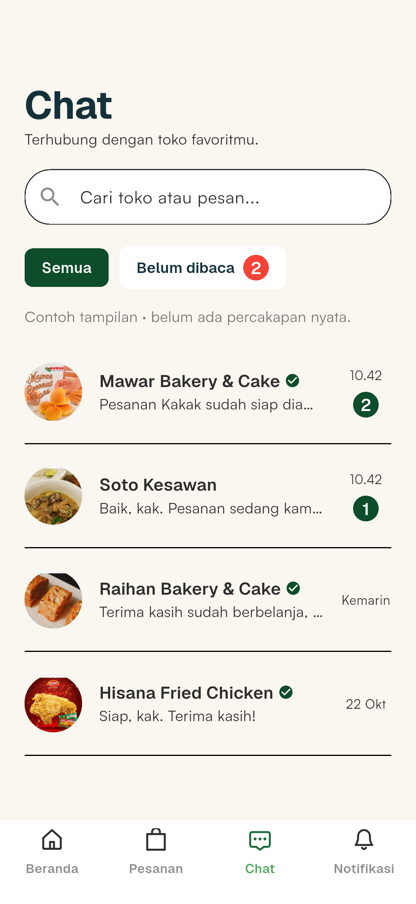

**How to reach it:** Select **Chat** from bottom navigation.

**What happens when you interact:** Search sample conversations and tap a merchant row to enter the example thread.

**Important limitation:** Conversations, unread counts and timestamps are static examples.


### Merchant chat example

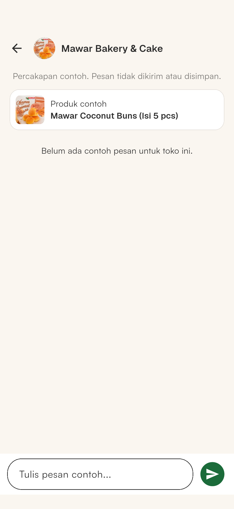

**How to reach it:** Select a chat row or choose **Chat Toko** from an active order example.

**What happens when you interact:** Type messages into the temporary local conversation preview.

**Important limitation:** Messages are not delivered to a merchant, synced or persisted.


### Notifications

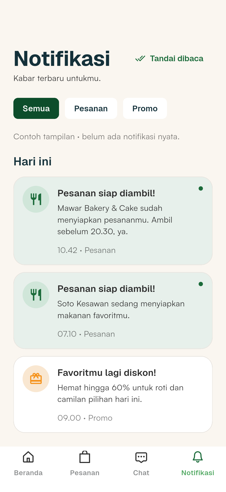

**How to reach it:** Select **Notifikasi** from bottom navigation or tap the Home bell icon.

**What happens when you interact:** Filter example notices, open a card or change its read state locally.

**Important limitation:** There is no push delivery or persisted notification history. Both navigation paths lead to this same view.


[Back to screen index](#screen-index)

---

## Profile, settings & support

### Example profile

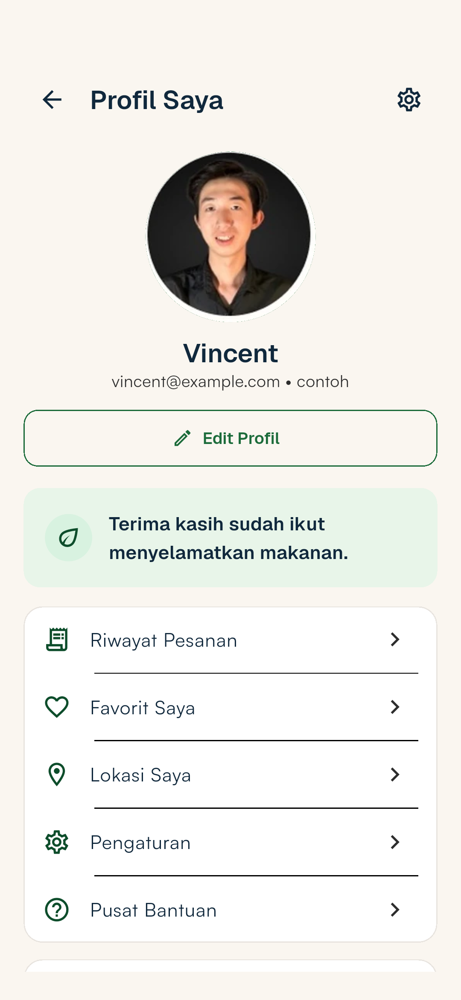

**How to reach it:** Tap the Home avatar.

**What happens when you interact:** Choose **Edit Profil**, **Favorit Saya**, **Pengaturan**, **Pusat Bantuan**, or the example area selector.

**Important limitation:** Displayed identity and account information are placeholders, not a signed-in user.


### Edit profile form

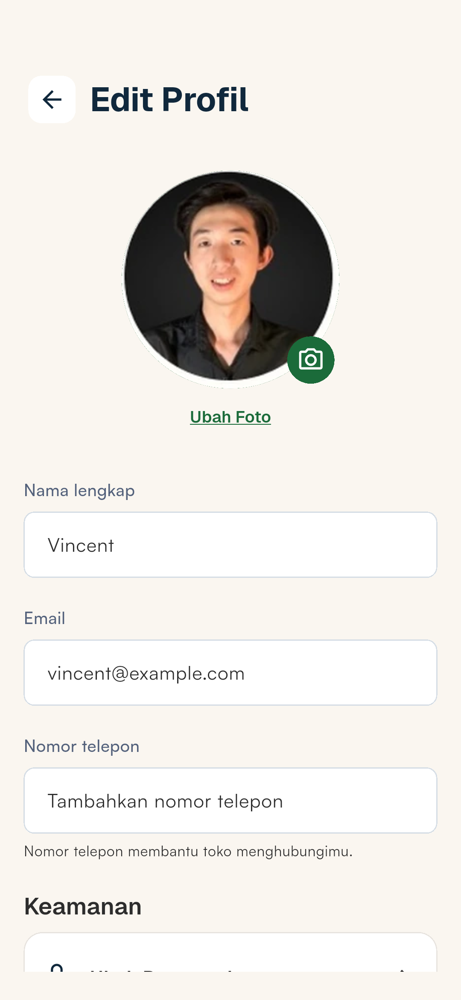

**How to reach it:** From Profile, choose **Edit Profil**.

**What happens when you interact:** Inspect and edit the illustrative fields.

**Important limitation:** Profile changes are not saved to an account.


### Favorites preview

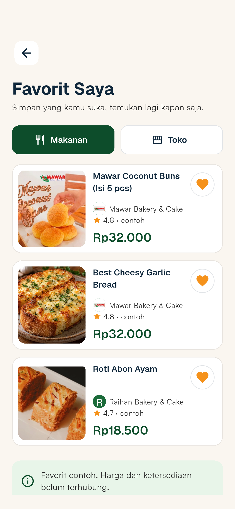

**How to reach it:** From Profile, choose **Favorit Saya**.

**What happens when you interact:** Switch between sample food and store favorites; remove local examples if offered.

**Important limitation:** These are not persisted account favorites.


### Settings

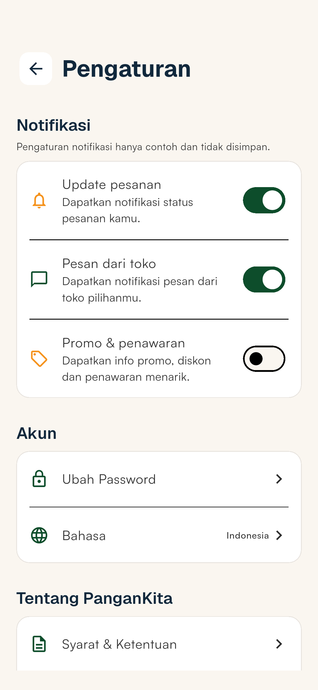

**How to reach it:** From Profile, choose **Pengaturan**.

**What happens when you interact:** Open **Syarat & Ketentuan**, **Kebijakan Privasi**, **Pusat Bantuan**, or example password recovery; notification switches are display-only.

**Important limitation:** Preferences and notification switches are not saved to an account.


### Terms status

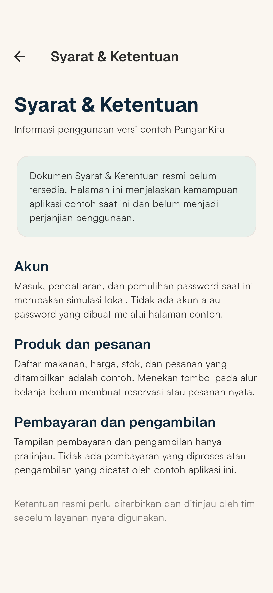

**How to reach it:** From Settings, select **Syarat & Ketentuan**.

**What happens when you interact:** Read the status of the currently unpublished formal terms and navigate back.

**Important limitation:** This is not a published legal agreement or a production policy.


### Support conversation preview

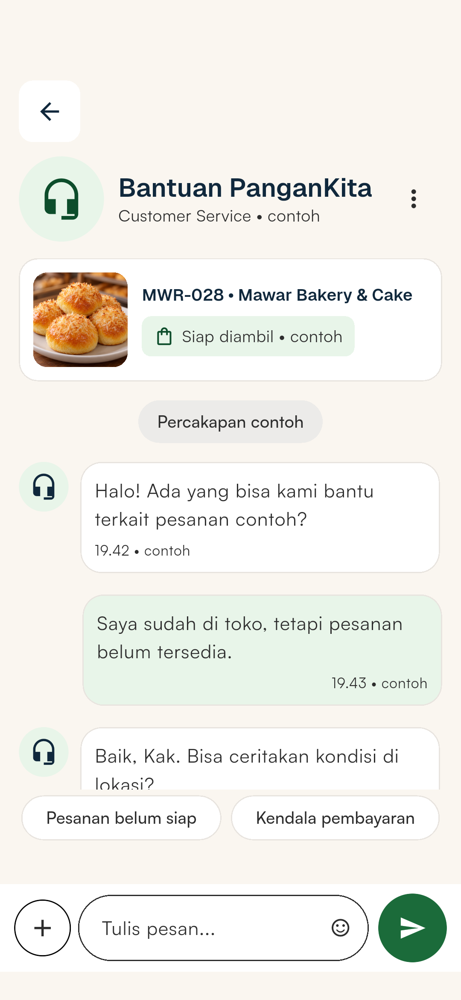

**How to reach it:** From Profile or Settings, choose **Pusat Bantuan**.

**What happens when you interact:** Select sample help prompts or compose text in the local support UI.

**Important limitation:** No message, attachment, or support request is submitted.


[Back to screen index](#screen-index)

---

## Notes for contributors

- These screenshots document current app-output examples, not third-party approved design references.
- When a screen changes, recapture it using the standardized automated runner and update the relevant screenshot and this walkthrough.
- Preserve the distinction between a visible interactive demo and a real server-backed operation.
- For the raw organized inventory, see the [screenshot catalog](screenshots/README.md).
- For setup and quality checks, see the [repository README](../README.md) and [Flutter app guide](../app/README.md).
